# B2B Keyboard Mapper

Windows 键盘转 MIDI 工具，适用于 B2B Studio 桌面版。工具通过 Studio 的 MIDI 映射控制控件，可以从界面配置按键、组合键、旋钮步进和 MIDI 通道。

## B2B Studio 网址：
[B2B Studio 网址](https://b2bstudio.live/)

## 第一次使用

1. 在[loopMIDI 官网](https://www.tobias-erichsen.de/software/loopmidi.html)下载安装并启动 loopMIDI，创建一个端口，并让 loopMIDI 保持运行。
2. 打开 `B2B Keyboard Mapper.exe`，点「刷新」并选中创建的端口。
3. 在工具界面的「映射界面」中点击「导入键位」,选中 `configs\bjm-v11.json` 。然后点击导出Studio预设并保存。
4. 进入 B2B Studio 的练习台或 DJ 房间，选择设备 BJM-V11，打开 **MIDI** 旁的 **▾**，选择 **Import**，选中上一步导出的文件。
5. 切回工具里点击「启用映射」，再切回 B2B Studio，即可开始打碟！
6. 要在 Studio 内打字时，先按 **F8** 暂停，打完再按 **F8** 恢复。

## 示例键位

导入 BJM-V11 示例配置后，左右手分别控制本组选中的 P2P-3000X 播放器和混音器通道。双键控件的键位按「减少 / 增加」排列。

| 控件 | 左手 | 右手 |
| --- | --- | --- |
| 播放器 · 播放 / 暂停 | `V` | `M` |
| 播放器 · CUE | `C` | `,` |
| 混音器 · 竖推 | `E` / `R` | `O` / `P` |
| 混音器 · 高频 | `Q` / `W` | `[` / `]` |
| 混音器 · 中频 / 中高频 | `A` / `S` | `;` / `'` |
| 混音器 · 低频 | `Z` / `X` | `.` / `/` |
| 混音器 · 中低频（V11） | `D` / `F` | `K` / `L` |
| 混音器 · 耳机预听 | `Shift+C` | `Shift+,` |
| 播放器 · 节拍同步 | `Shift+V` | `Shift+M` |
| 播放器 · 四拍循环 / 减半 | `T` | `I` |
| 播放器 · 退出 / 恢复循环 | `Shift+T` | `Shift+I` |
| 播放器 · Hot Cue A | `1` | `9` |
| 播放器 · Hot Cue B | `2` | `0` |
| 播放器 · Hot Cue C | `3` | `-` |
| 播放器 · Hot Cue D | `4` | `=` |
| 播放器 · Hot Cue E | `Shift+1` | `Shift+9` |
| 播放器 · Hot Cue F | `Shift+2` | `Shift+0` |
| 播放器 · Hot Cue G | `Shift+3` | `Shift+-` |
| 播放器 · Hot Cue H | `Shift+4` | `Shift+=` |
| 播放器 · 调速杆 | `Shift+Z` / `Shift+X` | `Shift+.` / `Shift+/` |
| 播放器 · Loop In | `Shift+E` | `Shift+O` |
| 播放器 · Loop Out | `Shift+R` | `Shift+P` |

**共用映射**　A10 交叉推子用 `G` 向左移动，用 `H` 向右移动。



## 左右分组功能

工具的配置分为左右两组，每组允许保存多个配置，组内配置可以实时切换。共用映射总是启用。
[BJM-V11 示例配置](configs/bjm-v11.json)是推荐的配置方法，即组内每个配置保存不同的deck，通过 F2 / F11 实时切换deck。当然你也可以把不同deck的控件放在同一配置内。

配置文件使用方法：
用「导入键位」加载 [BJM-V11 示例配置](configs/bjm-v11.json)，确认 MIDI 输出端口，再按「第一次使用」的步骤导出并导入 Studio 预设。每组的两个 Deck 共用上表的键位，切换时同时改变播放器和对应的混音器通道。

| 分组 | 默认控制 | 切换键 | 切换后的控制 |
| --- | --- | --- | --- |
| 左组 | Deck 2 / CH 2 | `F2` | Deck 1 / CH 1 |
| 右组 | Deck 3 / CH 3 | `F11` | Deck 4 / CH 4 |

- 在「编辑」里选择左组、右组或共用映射。每组可新增、重命名、删除 Deck，以及设置默认 Deck 和切换键。Deck 名称自定义，一套配置可同时包含不同播放器和通道的控件。
- 映射启用且 Studio 在前台时，按切换键按列表顺序循环。顶部显示两侧当前配置。切换时会释放该侧旧配置的键，松开后再按即可操作新配置。
- 同组的不同 Deck 可以使用相同键位。左右组、共用映射和切换键的键位需要区分。若要在另一套 Deck 使用同一 Studio 控件，点「复用映射」，选择已有控件并为新映射录入键位。导出的 Studio 预设包含所有 Deck 和共用映射。
- 旧键位导入后会出现在共用映射中。可在左组或右组新增 Deck，再用「移动所选」分配旧映射。保存键位后会使用分组格式。

## 状态悬浮窗

悬浮窗在启动时显示映射开关和左右组当前生效的 Deck，主窗口最小化后仍会置顶，可拖动悬浮窗位置。主窗口的「显示悬浮窗」可在本次会话中隐藏或恢复显示。

## 自定义

- **换键**　暂停工具，双击对应键位单元格，再按键或按组合键。点击「保存键位」或「启用映射」后，本机自动保存配置。可以用「导入键位」和「导出键位」备份。只改键位和步进时，Studio 可以继续使用原 MIDI 预设。
- **增加控件**　添加一行，填上名称、类型、键位和未使用的 Note / CC 编号。在 B2B Studio 点击 **MIDI** 开启学习，点一下目标控件，控件周围会出现选中的黄圈。回到工具选中该行，点「绑定选中控件」，等待工具显示控件 ID 已保存。工具会把学到的 ID 追加到该行并去重。完成后可在 B2B Studio 再按一次 **MIDI** 退出学习。
- **按钮**　按下发送 Note On，松开时发送 Note Off。适合 PLAY、CUE 等控件。
- **相对旋钮**　按键从控件当前位置增减，长按连续调节。绑定后可在 Studio 的 **WHEEL TUNING** 确认类型为 **REL 2**。要用相对步进控制推子，请填写 Studio 控件 ID 并导出预设。
- **绝对cc**　使用工具记录的 0–127 数值，适合通过 MIDI 学习绑定绝对位置的推子。每次启动工具后从「初始值」开始，首次操作可能把推子带到该位置附近。

如果工具提示未确认控件，请检查 Studio 已开启学习并选中控件。Studio 的 MIDI 输入端口与工具的输出端口名称不同时，在「Studio 输入」填写 Studio 显示的名称。若 ID 已绑定另一条 MIDI 信号，可用「复用映射」沿用该绑定。可在一行填多个 ID，用逗号分隔。

## 从源码编译

在仓库目录的 PowerShell 中运行以下命令。编译前关闭正在运行的工具。

```powershell
$framework = Join-Path $env:WINDIR 'Microsoft.NET\Framework64\v4.0.30319'
& (Join-Path $framework 'csc.exe') /nologo /target:winexe /optimize+ /codepage:65001 `
    '/out:B2B Keyboard Mapper.exe' /reference:System.Web.Extensions.dll `
    "/reference:$framework\WPF\UIAutomationClient.dll" "/reference:$framework\WPF\UIAutomationTypes.dll" `
    "/reference:$framework\WPF\WindowsBase.dll" Mapper.cs Window.cs StudioLearning.cs StatusOverlay.cs ConsoleTheme.cs
```
